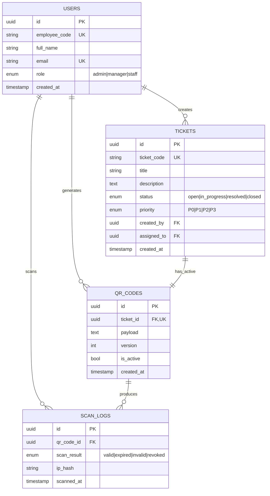

# Architecture — Ticket QR Code Generator Worker

**Ticket:** ENG-139055
**Epic:** Core Infrastructure Overhaul
**Priority:** P1 (High)
**Owner:** Yash Raj [PDIT-INT-1247]

---

## 1. Entity Relationship Diagram (ERD)



### Design Notes
- `QR_CODES.ticket_id` is UNIQUE — 1 active QR per ticket.
- Regeneration supported via `version` field; old QR set to `is_active = false`.
- `ip_hash` used instead of raw IP — privacy-safe telemetry (no PII).
- Audit events stored separately for compliance / analytics.

---

## 2. API Contracts

Base URL: `https://<vercel-app>.vercel.app/api`

### `POST /api/tickets` — Create ticket
**Request:**
```json
{
  "title": "Printer jam on floor 2",
  "description": "HP LaserJet not responding",
  "priority": "P1",
  "assigned_to": "uuid|null"
}
```
**201:** `{ "id": "uuid", "ticket_code": "TKT-2026-0001", "status": "open", "created_at": "ISO" }`
**400:** `{ "error": "VALIDATION_FAILED", "fields": { "title": "required" } }`

### `GET /api/tickets?status=&priority=&page=&limit=` — List
**200:** `{ "data": [ { "id": "uuid", "ticket_code": "TKT-2026-0001", "title": "...", "status": "open" } ], "meta": { "page": 1, "limit": 20, "total": 47 } }`
**200 (empty):** `{ "data": [], "meta": { "total": 0 } }` → UI shows "No data found"

### `GET /api/tickets/:id` — Detail
**200** | **404:** `{ "error": "NOT_FOUND" }`

### `PATCH /api/tickets/:id` — Update status
**Request:** `{ "status": "resolved" }` → **200** with updated entity.

### `POST /api/tickets/:id/qr` — Generate / regenerate QR
**Request:** `{ "expires_at": "ISO|null" }`
**201:** `{ "id": "uuid", "ticket_id": "uuid", "payload": "TKT-2026-0001|v1|sig", "version": 1, "is_active": true }`
- Old QR (if any) → `is_active: false`, new `version++`.
- Emits `AUDIT_EVENTS` row: `event_type: "qr.generated"`.

### `GET /api/tickets/:id/qr` — Fetch active QR
**200** with payload + version. **404** if none.

### `POST /api/qr/verify` — Scan verify (public)
**Request:** `{ "payload": "TKT-2026-0001|v1|sig" }`
**200:** `{ "result": "valid", "ticket": { "ticket_code": "TKT-2026-0001", "status": "open" } }`
Possible `result`: `valid | expired | invalid | revoked`.
Logs `SCAN_LOGS` row + `AUDIT_EVENTS` row.

### `GET /api/scan-logs?ticket_id=&page=&limit=` — Audit list
**200** paginated, same shape as tickets list.

### `POST /api/analytics/ping` — Telemetry
**Request:** `{ "event": "User interacted with Ticket QR Code Generator Worker", "context": "generate_qr" }`
**202 Accepted** — fire-and-forget. Also console.logs: `[Analytics] User interacted with Ticket QR Code Generator Worker`

---

## 3. Design Tokens (Monochromatic)

| Token | Hex |
|---|---|
| mono-0 | #FFFFFF |
| mono-50 | #FAFAFA |
| mono-100 | #F4F4F5 |
| mono-200 | #E4E4E7 |
| mono-400 | #A1A1AA |
| mono-600 | #52525B |
| mono-800 | #27272A |
| mono-900 | #18181B |

**Spacing scale:** 4 / 8 / 16 / 24 / 32 / 48 / 64 (16-32px steps enforced)
**No rogue hex colors allowed.**

---

## 4. Acceptance Criteria → Test Map

| ID | Type | Criterion | Test File |
|---|---|---|---|
| AC-01 | Happy | Form submit → QR renders | QrGenerator.test.tsx |
| AC-02 | Happy | Ticket list displays items | TicketList.test.tsx |
| AC-03 | Unhappy | Empty list → "No data found" | TicketList.test.tsx |
| AC-04 | Unhappy | Slow fetch → spinner visible | QrGenerator.test.tsx |
| AC-05 | Unhappy | Invalid input → red border + blocked submit | QrGenerator.test.tsx |
| AC-06 | NFR | `<script>` input sanitized | sanitize.test.ts |
| AC-07 | NFR | Generate → `[Analytics]` log emitted | telemetry.test.ts |
| AC-08 | NFR | Keyboard nav + ARIA labels | a11y.test.tsx |

---

## 5. Scope Note

This project ships as a **frontend-only SPA** (Vite + React + TS).
API contracts above are defined for backend integration (Capstone 1 deliverable)
and consumed via TypeScript types + mock service layer in `src/lib/mockApi.ts`.
No real API keys or PII are stored in the frontend.
